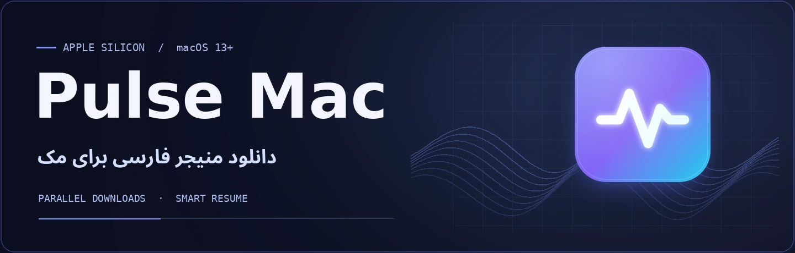
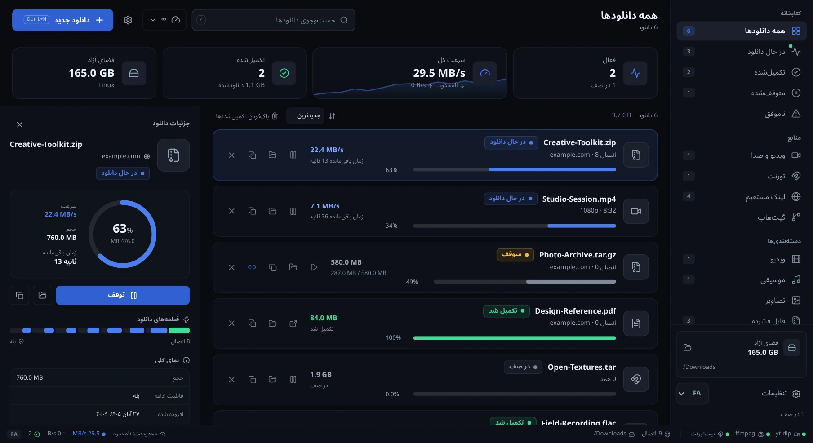

<div align="center">



<h1>پالس مک | Pulse Mac</h1>
<p><strong>دانلودهای بزرگ را چنداتصالی بگیر و بعد از قطع اینترنت از همان‌جا ادامه بده.</strong></p>

<p>
  <a href="#preview">نمای برنامه</a> ·
  <a href="#features">قابلیت‌ها</a> ·
  <a href="#performance">آزمون سرعت</a> ·
  <a href="#quick-start">شروع سریع</a> ·
  <a href="#guides">راهنماها</a> ·
  <a href="#english">English</a>
</p>

<p>
  
  
  
  
  <a href="LICENSE"></a>
</p>

</div>

---

**Pulse Mac** یک دانلود منیجر محلی برای مک‌های Apple Silicon است. لینک مستقیم، ویدئو، تورنت و فایل‌های GitHub را در یک صف مدیریت کن. رابط فارسی و راست‌چین، منوی بومی مک، و ذخیرهٔ پیشرفت دانلود در کنار فایل موقت، پیگیری و بازیابی دانلودها را ساده‌تر می‌کند.

<a id="preview"></a>
## یک نگاه به Pulse Mac

<div align="center">
  
  <p><sub>نمای رابط همین پروژه در Chromium با دادهٔ نمونه.</sub></p>
</div>

<a id="features"></a>
## قابلیت‌ها

<table>
  <tr>
    <td width="50%" valign="top">
      <h3>⚡ دانلود چنداتصالی</h3>
      <p>تا ۱۶ اتصال برای لینک مستقیم سازگار با Range. هر اتصال آزاد قطعهٔ بعدی را می‌گیرد. با سیگنال محدودیت سرور، تعداد درخواست‌های هم‌زمان پایین می‌آید.</p>
    </td>
    <td width="50%" valign="top">
      <h3>↻ ادامه و بررسی فایل</h3>
      <p>پیشرفت دانلود روی دیسک ثبت می‌شود تا بعد از قطع اتصال یا بسته‌شدن برنامه بازیابی شود. با وارد کردن SHA‑256 می‌توان فایل نهایی را بررسی کرد.</p>
    </td>
  </tr>
  <tr>
    <td valign="top">
      <h3>🎬 ویدئو و تورنت</h3>
      <p>انتخاب کیفیت و دریافت ویدئو با yt-dlp، ادغام و استخراج صدا در صورت نصب FFmpeg، و دریافت Magnet یا فایل تورنت از طریق DHT عمومی.</p>
    </td>
    <td valign="top">
      <h3>📥 صف و دانلود گروهی</h3>
      <p>چند لینک را یک‌جا وارد کن، وظیفه‌ها را توقف و ادامه بده، یا فایل‌های انتشار و آرشیوهای GitHub را از داخل برنامه به صف اضافه کن.</p>
    </td>
  </tr>
  <tr>
    <td valign="top">
      <h3>🍎 یکپارچگی با macOS</h3>
      <p>منوی بومی، کنترل صف در نوار منو، اعلان پایان دانلود، باز کردن فایل تورنت از Finder و اجرای اختیاری هنگام ورود.</p>
    </td>
    <td valign="top">
      <h3>🔐 داده‌های محلی</h3>
      <p>ذخیرهٔ اتمیک تنظیمات و پیشرفت، نسخهٔ پشتیبان از وضعیت برنامه و محافظت از توکن اختیاری GitHub با Keychain.</p>
    </td>
  </tr>
</table>

<a id="performance"></a>
## سرعت در آزمون کنترل‌شده

| شرایط سرور محلی | مبنا | Pulse Mac | نتیجه |
| --- | ---: | ---: | ---: |
| سقف سرعت جداگانه برای هر اتصال | ۴٫۱۰۷ ثانیه با یک اتصال | ۰٫۵۴۹ ثانیه با هشت اتصال | **۷٫۵ برابر** |
| سرعت نابرابر قطعه‌ها | ۲٫۱۷۵ ثانیه در نسخهٔ قبلی | ۰٫۶۷۲ ثانیه با زمان‌بندی جدید | **۳٫۲ برابر** |

هر عدد میانهٔ سه دانلود فایل ۳۲ MiB با تطبیق SHA‑256 است. ردیف دوم در هر دو نسخه با هشت اتصال اندازه‌گیری شد. سرعت روی اینترنت به پهنای باند، شیوهٔ محدودیت سرور و پشتیبانی از Range بستگی دارد. [شرایط و روش بازتولید](docs/MAC_TEST_REPORT.md#سنجش-سرعت-http)

<a id="quick-start"></a>
## شروع سریع روی مک

نیازمندی ساخت **macOS 13 یا جدیدتر، Apple Silicon و Node.js 24.22.1 برای ARM64** است. برای ساخت از سورس:

```bash
git clone https://github.com/erfand39/pulse-mac.git
cd pulse-mac
npm ci
npm run dist:mac:arm64
```

بسته‌ها در `dist/` قرار می‌گیرند. نسخهٔ محلی برنامه را می‌توان با `open "dist/mac-arm64/Pulse Mac.app"` باز کرد. در زمان انتشار سورس، باندل متقاطع ARM64 از لینوکس بررسی معماری شده و اجرای بسته روی M1 در گزارش آزمون هنوز تأیید نشده است. [راهنمای فارسی نصب، امضا و بازیابی](README_MAC_FA.md)

برای توسعه:

```bash
npm run dev:mac
npm run typecheck
npm run lint
npm test
npm run bench:http
```

<a id="guides"></a>
## راهنماها

| موضوع | راهنما |
| --- | --- |
| نصب، دانلود، FFmpeg و بازیابی | [راهنمای فارسی](README_MAC_FA.md) |
| صف، چک‌پوینت، زمان‌بندی HTTP و ذخیره‌سازی | [معماری](docs/MAC_ARCHITECTURE.md) |
| آزمون‌ها، سرعت و وضعیت اجرای Mac | [گزارش آزمون](docs/MAC_TEST_REPORT.md) |
| Keychain، محدودیت‌ها و امضای بسته | [یادداشت‌های امنیتی](docs/SECURITY_NOTES.md) |
| ساخت و بررسی بسته روی runner مک | [GitHub Actions](.github/workflows/release.yml) |

<a id="english"></a>
## English

Pulse Mac is an Apple Silicon download manager with a Persian RTL interface. It queues direct HTTP, yt-dlp, public BitTorrent and GitHub downloads. Its HTTP engine schedules pieces across up to 16 connections, respects server backoff and stores progress for recovery after interruption. Optional SHA-256 verification checks the final file.

On a local 32 MiB benchmark, eight HTTP connections were **7.5× faster** than one under a per-connection bandwidth cap. With slow and fast pieces in the same download, the new scheduler was **3.2× faster** than the previous scheduler using eight connections in both cases. The [test report](docs/MAC_TEST_REPORT.md) records the setup and macOS verification status.

Build on Apple Silicon with macOS 13+ and Node.js 24.22.1 by running `npm ci && npm run dist:mac:arm64`.

## منبع و مجوز · Credits

Pulse Mac فورک مک پروژهٔ Pulse Download Manager از TheGreatAzizi، بر پایهٔ `v1.0.20` است. مجوز **GPL-3.0-or-later** و انتساب آیکون و سورس حفظ شده‌اند. [پروژهٔ اصلی](https://github.com/TheGreatAzizi/Pulse-Download-Manager) · [NOTICE](NOTICE) · [LICENSE](LICENSE)
